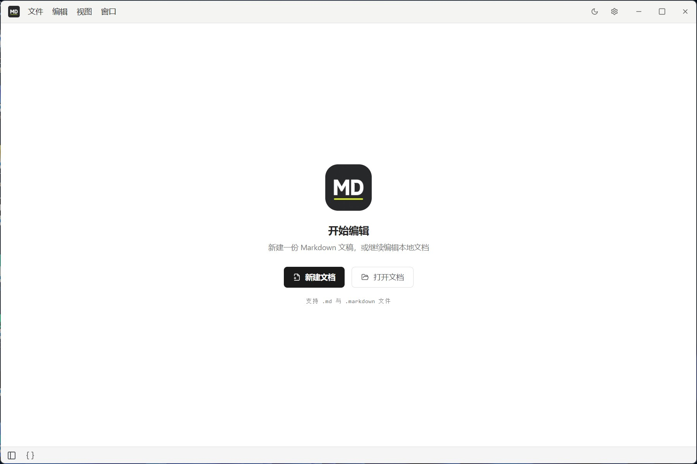
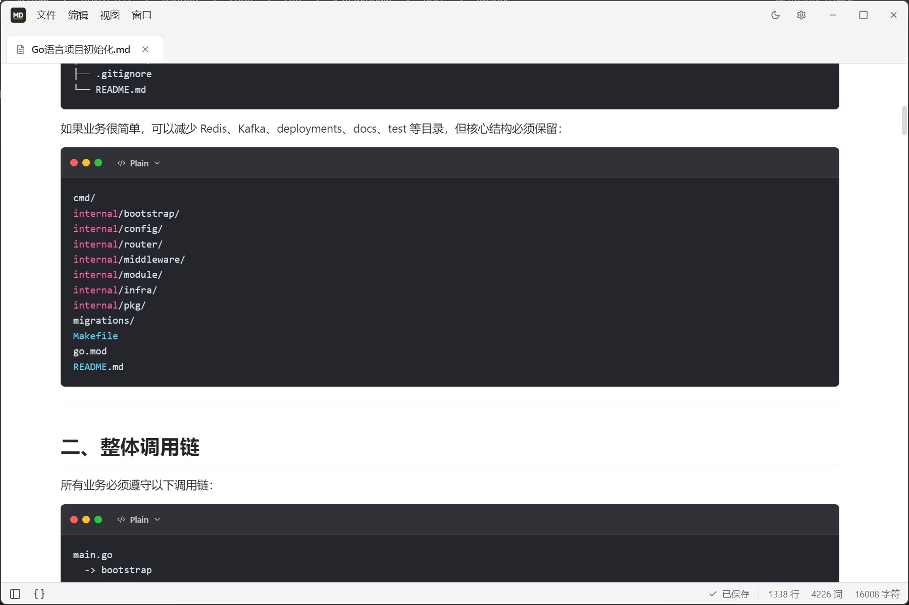
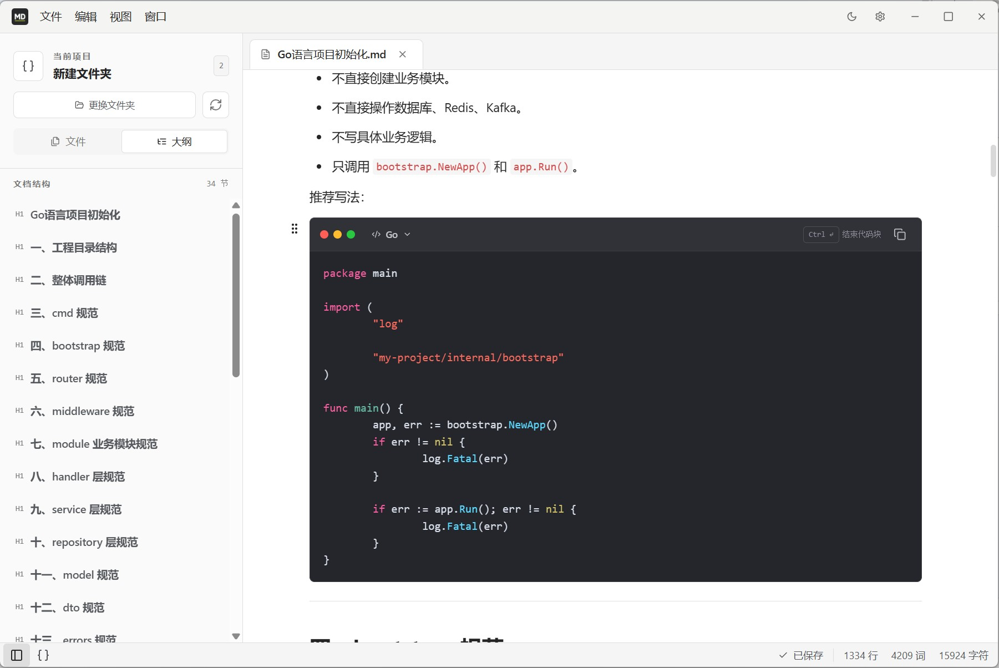
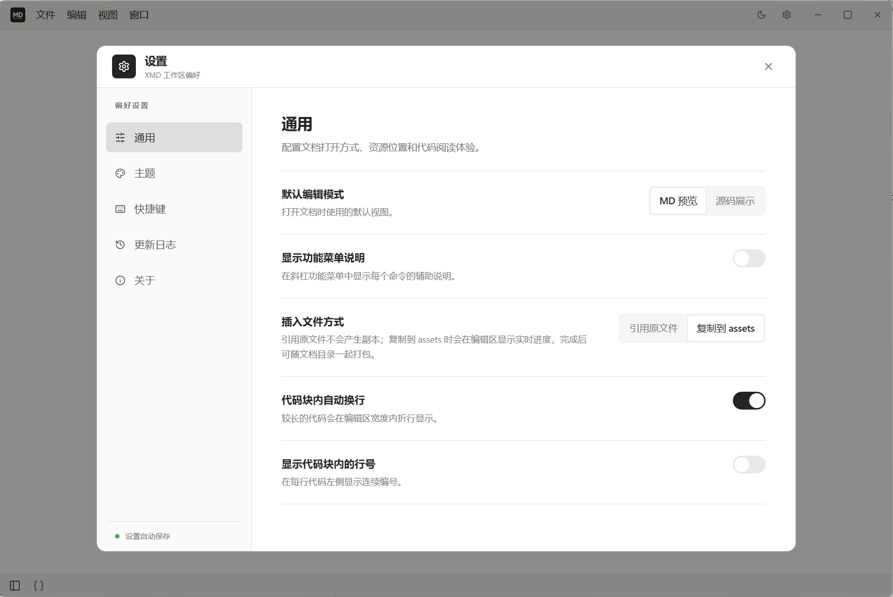
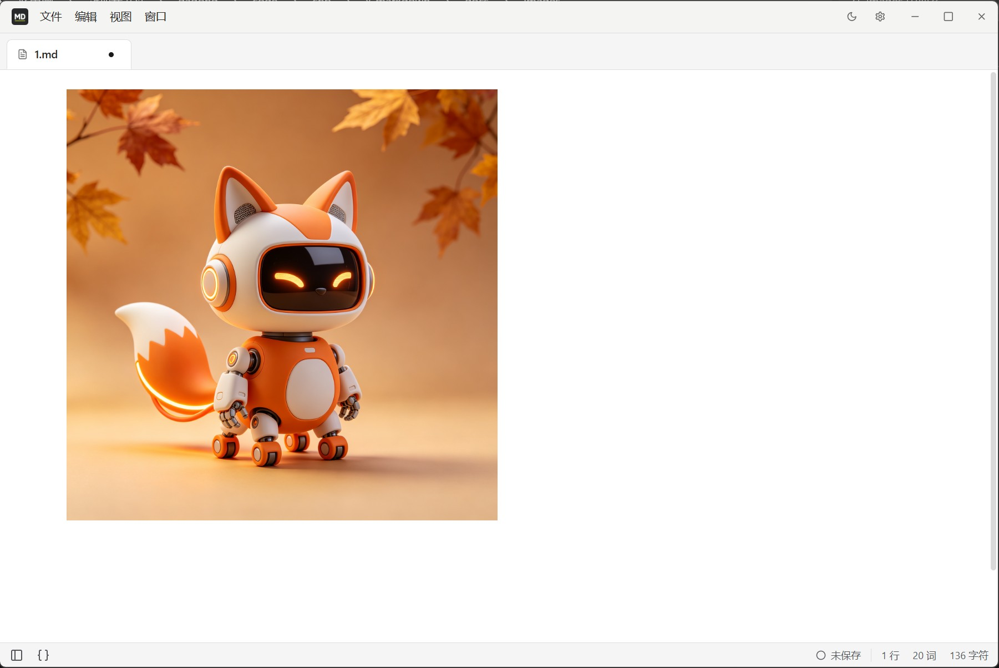

# XMD

[简体中文](README.zh-CN.md)

Website: [https://www.x-markdown.com](https://www.x-markdown.com)

Author: dadong

XMD is a local Markdown editor built with Electron, Vue 3, TipTap, and TypeScript. It offers both a what-you-see-is-what-you-get experience and a source editing mode.

## Screenshots

### Welcome screen



### Markdown preview



### Workspace and document outline



### General settings



### Image preview



### Attachments and video


## Features

- WYSIWYG and Markdown source modes; each tab remembers its editing mode
- Multi-tab documents: create, batch open, save, save as, and reorder tabs
- Recent files list on the welcome screen and in the File menu; stale entries are cleaned up automatically
- Tables, task lists, syntax highlighting, links, images, video, and attachments
- Standalone folder workspaces with lazy directory expansion and automatic refresh on external changes
- Document outline, line/word/character counts, light and dark themes
- Disk conflict detection and atomic writes, so external changes are never silently overwritten
- Save all, discard changes, or cancel when quitting
- Automatic recovery of unsaved drafts; drafts are cleaned up after saving or explicitly discarding
- Configurable auto save after you stop typing; unnamed documents still need to be saved manually
- Installers for Windows, macOS, and Linux, plus in-app update checks
- File associations: after installation, double-click .md / .markdown / .txt files to open them with XMD; Windows also provides an "Open with XMD" context menu entry

## Development

The project uses Bun 1.3.14, matching CI.

```powershell
bun install --frozen-lockfile
bun run dev
```

Common checks:

```powershell
# Renderer type check
bun run typecheck

# Electron main process and preload type check
bunx tsc --noEmit -p tsconfig.node.json

# Check without modifying files
bun run lint

# Automatically fix fixable lint issues
bun run lint:fix

# Production build
bun run build
```

## Installation

Installers are published on the [download page](https://www.x-markdown.com/download) and [GitHub Releases](https://github.com/mr-dadong/x-markdown/releases). Choose the file for your system and chip. On Windows, download the exe and follow the wizard. The macOS and Linux steps are below.

### macOS

Apple Silicon (M series) users should download `XMD-<version>-macOS-arm64.dmg`; Intel users should download `XMD-<version>-macOS-x64.dmg`. macOS 12 or later is required.

1. Open the DMG and drag the XMD icon into the Applications folder.
2. The first launch is blocked by Gatekeeper because the package is not code-signed. In Applications, Control-click the XMD icon, choose Open, and confirm in the dialog. If there is no Open item, go to System Settings → Privacy & Security and click Open Anyway.
3. A message saying "XMD is damaged" means the system applied a quarantine attribute. Remove it in Terminal and open the app again:

   ```bash
   xattr -dr com.apple.quarantine /Applications/XMD.app
   ```

### Linux

On x86_64 machines, download `XMD-<version>-Linux-x86_64.AppImage`; on arm64, download `XMD-<version>-Linux-arm64.AppImage`. A mainstream 64-bit Linux distribution is required.

1. Open a terminal in the folder containing the AppImage, make it executable, and run it:

   ```bash
   chmod +x XMD-<version>-Linux-x86_64.AppImage
   ./XMD-<version>-Linux-x86_64.AppImage
   ```

2. If FUSE is missing (Ubuntu 22.04 and newer do not include libfuse2 by default), install the dependency or start in FUSE-free mode:

   ```bash
   sudo apt install libfuse2
   ./XMD-<version>-Linux-x86_64.AppImage --appimage-extract-and-run
   ```

3. To get a menu icon and .md file associations, move the AppImage to a stable directory such as `~/.local/bin` and use AppImageLauncher for desktop integration.

## Usage

- `Ctrl+N`: new document
- `Ctrl+O`: open one or more documents
- `Ctrl+S`: save
- `Ctrl+Shift+S`: save as
- `Ctrl+B`: show or hide the sidebar
- `Ctrl+,`: open settings

"Open Folder" in the sidebar creates a standalone workspace. The workspace path is stored in the Electron user data directory and restored on the next launch. The file tree refreshes automatically when files inside the workspace are added, deleted, or renamed.

Unsaved content is written to the Electron user data directory. After an abnormal exit, these tabs are restored on the next launch. Drafts are cleaned up after a normal save, closing and discarding, or quitting and discarding.

After installation, double-click a `.md`, `.markdown`, or `.txt` file to open it directly with XMD. In Windows Explorer you can also choose "Open with XMD" from the context menu. If the app is already running, newly opened files appear as new tabs in the existing window.

## Building installers

```powershell
bun run dist:win
bun run dist:mac
bun run dist:linux
```

Artifacts are written to `release/`. Windows uses NSIS, macOS uses DMG, and Linux uses AppImage. Packages are not code-signed, so the operating system may show an unknown publisher warning.

## Automated releases

`.github/workflows/build.yml` supports manual builds and also builds all three platforms and creates a GitHub Release when a `v*` tag is pushed. The version in `package.json` must match the tag before releasing:

```powershell
git tag v1.0.3
git push origin v1.0.3
```

## Code signing policy

Free code signing is provided by [SignPath.io](https://signpath.io/), with a
certificate issued by the [SignPath Foundation](https://signpath.org/).

- Committer and reviewer: [mr-dadong](https://github.com/mr-dadong)
- Approver: [mr-dadong](https://github.com/mr-dadong)
- Full policy: [CODE_SIGNING_POLICY.md](CODE_SIGNING_POLICY.md)
- Privacy policy: [PRIVACY.md](PRIVACY.md)

## Directory layout

```text
electron/   Electron main process, preload, IPC, and path permissions
src/        Vue UI, editor extensions, composable state, and services
functions/  Cloudflare Pages Functions
worker/     Cloudflare Worker
site/       Project website
build/      Installer resources
changelogs/ App update manifests and release notes
```

## License

[GNU General Public License v3.0](LICENSE)
