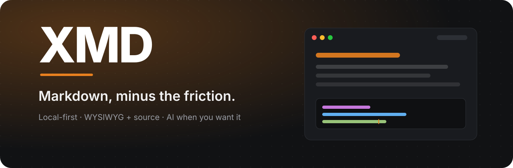

<div align="center">
  
</div>

<div align="center">

<h1>XMD</h1>

**本地优先的 Markdown 编辑器：所见即所得、源码模式，外加随叫随到的 AI。**

[English](README.md) · 简体中文

[](https://github.com/mr-dadong/x-markdown/releases)
[](LICENSE)
[](https://www.x-markdown.com/download)
[](https://github.com/mr-dadong/x-markdown/releases)

[](https://github.com/mr-dadong/x-markdown/stargazers)
[](https://www.x-markdown.com)

[**下载**](https://www.x-markdown.com/download) · [**官网**](https://www.x-markdown.com) · [**更新日志**](https://www.x-markdown.com/changelog) · [**Releases**](https://github.com/mr-dadong/x-markdown/releases)

</div>

---

## 为什么选 XMD

- **本地优先，无需账号。** 文档始终保存在磁盘上；只有你主动使用自己的模型服务时，内容才会离开本机。
- **一套文档，两种编辑方式。** 在所见即所得与源码模式之间随时切换，每个标签页独立记忆编辑模式和阅读位置。
- **Markdown 该有的样子。** 标准 Markdown 之外，还支持表格、任务列表、数学公式、Mermaid、提示块、脚注、实时目录，以及无损往返的块级 HTML。
- **用自己的 AI。** 与文档对话，或让文档 Agent 逐行提出修改供你审阅；使用自己的 API Key，不配置也能完整使用编辑功能。

<br />

## 功能亮点

<table>
  <tr>
    <td width="50%" valign="top">
      <h3>✍️ 所见即所得 + 源码</h3>
      富文本与原始 Markdown 一键切换，每个标签页独立记忆模式与阅读位置。
    </td>
    <td width="50%" valign="top">
      <h3>🗂️ 多标签工作区</h3>
      标签页、最近打开、文件夹工作区、按需展开的文件树，以及外部改动自动刷新。
    </td>
  </tr>
  <tr>
    <td width="50%" valign="top">
      <h3>🧭 大纲与排版</h3>
      实时大纲、行数与字符数、主题、正文字体、行宽、预览缩放与代码块样式。
    </td>
    <td width="50%" valign="top">
      <h3>🧩 扩展 Markdown</h3>
      目录、Mermaid 图表、KaTeX 公式、提示块、脚注、HTML 块、表格、任务列表与附件。
    </td>
  </tr>
  <tr>
    <td width="50%" valign="top">
      <h3>🤖 AI 对话 + 文档 Agent</h3>
      围绕文档提问、在光标处生成内容，或先审阅 Agent 提出的逐行修改再写入。
    </td>
    <td width="50%" valign="top">
      <h3>📤 完整导出</h3>
      HTML、PDF、Word（DOCX）、PNG、纯文本与 ZIP，ZIP 自动打包本地资源；PDF 支持页眉页脚与分页。
    </td>
  </tr>
  <tr>
    <td width="50%" valign="top">
      <h3>🗜️ 直接编辑 ZIP</h3>
      把 .zip 当作工作区打开，保存时写回原压缩包，失败时给出明确原因。
    </td>
    <td width="50%" valign="top">
      <h3>🛡️ 默认安全</h3>
      原子写入、外部修改检测、草稿恢复，文件访问仅限已授权路径。
    </td>
  </tr>
  <tr>
    <td width="50%" valign="top">
      <h3>🌍 中英双语界面</h3>
      简体中文与 English 跟随系统语言，也可以在设置中随时切换。
    </td>
    <td width="50%" valign="top">
      <h3>🖥️ 跨平台</h3>
      Windows、macOS 与 Linux AppImage 安装包，支持文件关联与应用内更新检查。
    </td>
  </tr>
</table>

<details>
<summary><b>📋 完整功能列表</b></summary>

- 所见即所得和 Markdown 源码模式，可保留每个标签页的编辑模式
- 多标签文档，新建、批量打开、保存、另存为和标签排序
- 最近打开文件列表：欢迎页和文件菜单可快速回到最近编辑过的文档，失效条目自动清理
- 独立文件夹工作区、按需展开目录和外部文件变化自动刷新
- 文档大纲（支持过滤）、行数与字符数统计、浅色与深色主题
- 表格、任务列表、代码高亮、链接、图片、视频与附件
- 文档目录、Mermaid 图表、KaTeX 公式、提示块、脚注与隔离 HTML 块
- AI 对话（携带文档上下文）、AI 实时编写，以及可审阅修改的文档 Agent
- 导出 HTML、PDF、DOCX、PNG、纯文本与 ZIP（自动打包图片、附件与视频）
- PDF 导出支持纸张、页边距、自定义页眉页脚与一级标题前分页
- 直接打开 .zip 压缩包编辑，并把修改写回原压缩包
- 原子写入、磁盘修改冲突检测与未保存草稿恢复
- 可配置的自动保存：停止输入一段时间后自动写入磁盘，未命名文档仍需手动保存
- 代码块行号、自动换行、语言选择、复制与 PNG 导出
- 内容块框选与拖动排序、表格工具栏
- 文件关联：双击 .md / .markdown / .txt 直接用 XMD 打开；Windows 右键菜单提供「使用 XMD 打开」
- 简体中文与 English 双语界面，跟随系统语言

</details>

---

## 界面预览

> 截图为中文界面，应用同样提供英文界面。

<table>
  <tr>
    <td width="50%">
      
      <br /><sub><b>工作区 + 大纲</b> — 文件树、实时大纲与代码块。</sub>
    </td>
    <td width="50%">
      
      <br /><sub><b>Markdown 预览</b> — 语法高亮与忠实渲染。</sub>
    </td>
  </tr>
  <tr>
    <td width="50%">
      
      <br /><sub><b>设置</b> — 语言、主题、排版、导出、快捷键与 AI。</sub>
    </td>
    <td width="50%">
      
      <br /><sub><b>图片预览</b> — 缩放、平移、适应宽度与系统应用打开。</sub>
    </td>
  </tr>
  <tr>
    <td width="50%">
      
      <br /><sub><b>附件与视频</b> — 卡片、复制进度与行内播放。</sub>
    </td>
    <td width="50%">
      
      <br /><sub><b>欢迎页</b> — 新建文档，或快速回到最近编辑。</sub>
    </td>
  </tr>
</table>

---

## 快速开始

<div align="center">

[](https://www.x-markdown.com/download)

</div>

- **Windows 10/11** — 下载 `.exe` 安装包，按向导安装。
- **macOS 12+** — Apple 芯片：`XMD-<版本>-macOS-arm64.dmg`；Intel：`XMD-<版本>-macOS-x64.dmg`。
- **Linux x86_64 / arm64** — 下载 AppImage，`chmod +x` 后运行。

<details>
<summary><b>安装说明（Gatekeeper、FUSE、桌面集成）</b></summary>

### macOS

1. 双击 DMG，把 XMD 图标拖进「应用程序」文件夹。
2. 首次启动会被 Gatekeeper 拦截，因为安装包没有代码签名。在「应用程序」中按住 Control 点击 XMD 图标，选择「打开」并确认；没有「打开」菜单时，到「系统设置 → 隐私与安全性」中点击「仍要打开」。
3. 提示「XMD 已损坏」说明应用被加上了隔离属性，在终端执行下面的命令解除隔离，然后重新打开：

   ```bash
   xattr -dr com.apple.quarantine /Applications/XMD.app
   ```

### Linux

1. 打开终端进入 AppImage 所在目录，赋予执行权限并运行：

   ```bash
   chmod +x XMD-<版本>-Linux-x86_64.AppImage
   ./XMD-<版本>-Linux-x86_64.AppImage
   ```

2. 提示缺少 FUSE 时（Ubuntu 22.04 及更新系统默认不带 libfuse2），安装依赖，或用免 FUSE 方式启动：

   ```bash
   sudo apt install libfuse2
   ./XMD-<版本>-Linux-x86_64.AppImage --appimage-extract-and-run
   ```

3. 需要开始菜单图标和 `.md` 文件关联时，把 AppImage 移到 `~/.local/bin` 等固定目录，再用 AppImageLauncher 完成桌面集成。

</details>

---

## 快捷键

| 快捷键 | 功能 |
| --- | --- |
| `Ctrl+N` | 新建文档 |
| `Ctrl+O` | 打开一个或多个文档 |
| `Ctrl+S` | 保存 |
| `Ctrl+Shift+S` | 另存为 |
| `Ctrl+B` | 显示或隐藏侧栏 |
| `Ctrl+,` | 打开设置 |

快捷键可在「设置 → 快捷键」中自定义，并同步到系统菜单的加速键。

---

## 技术栈


## 开发

项目使用 Bun 1.3.14，版本与 CI 保持一致。

```bash
bun install --frozen-lockfile
bun run dev
```

常用检查命令：

```bash
bun run typecheck                        # 渲染层
bunx tsc --noEmit -p tsconfig.node.json  # 主进程与 preload
bun run lint
bun test ./src
bun run build
```

## 构建与发布

```bash
bun run dist:win
bun run dist:mac
bun run dist:linux
```

构建产物写入 `release/`（NSIS、DMG 与 AppImage）。安装包未配置代码签名，操作系统可能显示未知发布者提示。

推送 `v*` 标签会触发 `.github/workflows/build.yml`：构建三个平台、创建 GitHub 与 CNB Release、写入安装包 SHA-256 并同步更新清单。发布前需保证 `package.json` 中的版本与标签一致：

```bash
git tag v1.3.12
git push origin v1.3.12
```

## 代码签名政策

Free code signing is provided by [SignPath.io](https://signpath.io/), with a certificate issued by the [SignPath Foundation](https://signpath.org/).

- Committer and reviewer: [mr-dadong](https://github.com/mr-dadong)
- Approver: [mr-dadong](https://github.com/mr-dadong)
- 完整政策：[CODE_SIGNING_POLICY.md](CODE_SIGNING_POLICY.md)
- 隐私政策：[PRIVACY.md](PRIVACY.md)

## 目录结构

```text
electron/   Electron 主进程、preload、IPC 与路径权限
src/        Vue 界面、编辑器扩展、组合式状态和服务
functions/  Cloudflare Pages Functions
site/       项目发布站点
build/      安装包资源
changelogs/ 应用更新清单与版本说明
```

## 许可证

[GNU General Public License v3.0](LICENSE)

<div align="center">

**如果 XMD 让你的写作顺手了一点，欢迎给个 Star。**

[](https://github.com/mr-dadong/x-markdown/stargazers)

<sub>由 <a href="https://github.com/mr-dadong">dadong</a> 用咖啡和过多的标签页构建。</sub>

</div>
